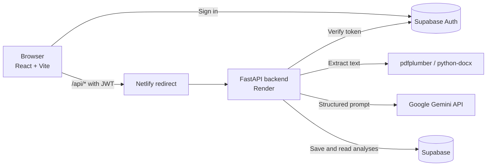

<div align="center">

# TalentEdge

### AI resume analyzer: see your resume the way a recruiter does

Upload a PDF or DOCX and get a structured review covering ATS readiness, strengths, gaps, keyword matching and concrete rewrites.

[](https://talentedge-resume-analyzer.netlify.app/)


</div>

> **Note:** the backend runs on a free instance that sleeps when idle. If the first request is slow, give it up to a minute to wake up.

<!--
Add screenshots: create a /screenshots folder, upload images, then uncomment.

<p align="center">
  
  
</p>
-->

## Table of contents

- [Overview](#overview)
- [Features](#features)
- [Architecture](#architecture)
- [Tech stack](#tech-stack)
- [API reference](#api-reference)
- [Engineering decisions](#engineering-decisions)
- [Getting started](#getting-started)
- [Environment variables](#environment-variables)
- [Testing](#testing)
- [Deployment](#deployment)
- [Roadmap](#roadmap)
- [Author](#author)

## Overview

Many resume checkers return a vague score with no explanation. TalentEdge ties every strength and weakness back to the resume's own text, rewrites weak bullets without inventing facts, and can tailor the review to a target role, company or job description.

It is a full-stack project: a React single-page app, a FastAPI backend, Supabase for authentication and data, and Google Gemini for the analysis, deployed on Netlify and Render.

## Features

**Analysis**
- Upload **PDF or DOCX** resumes
- **Overall and ATS scores** with strengths, gaps and concrete fixes
- **Evidence-based feedback** that points back to the actual resume text
- **Honest rewrites**: stronger bullets that keep your real facts, with placeholders where numbers are missing
- **Role tailoring**: add a target role, company or job description for matched and missing keywords

**Product**
- Sign in with **email or Google** (Supabase Auth), with password reset
- **History** of past analyses: reopen or delete any report
- Visual report with score meter, score ring and charts
- Animated scan experience and a "recruiter" mascot that gives tips
- Account page, Privacy Policy and Terms of Service pages

**Reliability and safety**
- Per-user **rate limiting** on the analysis endpoint
- Configurable **limits** on file size, PDF pages and resume length
- The model's output is **validated against a schema** before it is used
- Secrets live in environment variables, never in the repository

## Architecture



**Request flow**
1. The user signs in, and Supabase issues a JWT access token.
2. The app uploads the resume to `/api/analyze` with the token in the `Authorization` header.
3. FastAPI verifies the token, applies the rate limit and size limits, and extracts the text.
4. The text goes into a structured prompt, and Gemini returns the analysis.
5. The response is validated, saved and returned.
6. The frontend renders the report, which also appears in the user's History.

## Tech stack

| Layer | Technologies |
|---|---|
| Frontend | React 18, Vite, Tailwind CSS, React Router, Framer Motion, Lucide icons |
| Backend | Python, FastAPI, Uvicorn, httpx |
| Parsing | pdfplumber, python-docx |
| AI | Google Gemini API |
| Auth and database | Supabase |
| Testing | pytest |
| Hosting | Netlify (frontend), Render (backend) |

## API reference

All routes are served under `/api`. Protected routes expect `Authorization: Bearer <access_token>`.

| Method | Endpoint | Description | Auth |
|---|---|---|---|
| `GET` | `/api/health` | Health check | No |
| `POST` | `/api/analyze` | Upload a resume (multipart form) and receive an analysis | Yes |
| `GET` | `/api/analyses` | List the signed-in user's analyses | Yes |
| `GET` | `/api/analyses/{id}` | Fetch one analysis | Yes |
| `DELETE` | `/api/analyses/{id}` | Delete an analysis | Yes |

## Engineering decisions

- **Validated model output.** Language models can return malformed or incomplete output, so the response is checked against a schema before it reaches the user.
- **Rate limits and input limits.** Each analysis costs an API call, so requests are limited per user, and file size, PDF pages and resume length are capped.
- **Secrets stay server-side.** The Gemini key exists only in the backend environment. The browser holds only the public Supabase anon key.
- **Separate hosting for frontend and backend.** A Netlify redirect forwards `/api/*` to the backend, and CORS on the backend is restricted to known origins.
- **Model names are configuration.** I switched models without code changes when one was deprecated or overloaded. A diagnostic script (`backend/test_gemini.py`) lists the available models and checks the key.
- **Custom design system.** A Tailwind theme with a paper-and-ink palette, a single brand colour and a serif display font keeps the UI consistent.

## Getting started

**Prerequisites:** Python 3.10+, Node.js 18+, a [Gemini API key](https://aistudio.google.com/) and a [Supabase](https://supabase.com/) project.

**1. Clone the repository**
```bash
git clone https://github.com/sanidhyasalgotra/TalentEdge.git
cd TalentEdge
```

**2. Start the backend**
```bash
cd backend
python -m venv .venv
.venv\Scripts\activate          # Mac/Linux: source .venv/bin/activate
pip install -r requirements.txt
# create backend/.env (see below)
uvicorn app.main:app --reload --port 8000
```

**3. Start the frontend**
```bash
cd frontend
npm install
# create frontend/.env (see below)
npm run dev
```

The app runs at `http://localhost:5173`. In development, Vite proxies `/api` to `http://localhost:8000`.

## Environment variables

**`backend/.env`**
```env
GEMINI_API_KEY=your_gemini_api_key
GEMINI_MODEL=your_gemini_model_name
GEMINI_TIMEOUT_SECONDS=60
SUPABASE_URL=your_supabase_project_url
SUPABASE_ANON_KEY=your_supabase_anon_key
MAX_UPLOAD_MB=5
MAX_PDF_PAGES=10
MAX_RESUME_CHARS=20000
# add the rate limit variable here (confirm its exact name in backend/app/config.py)
ALLOWED_ORIGINS=http://localhost:5173
```

**`frontend/.env`**
```env
VITE_SUPABASE_URL=your_supabase_project_url
VITE_SUPABASE_ANON_KEY=your_supabase_anon_key
```

> `.env` files are git-ignored. Never commit real keys.

## Testing

```bash
cd backend
pytest
```

To check your Gemini key and see which models are available:

```bash
cd backend
python test_gemini.py
```

## Deployment

| Service | Platform | Key settings |
|---|---|---|
| Frontend | Netlify | Base directory `frontend`, build `npm run build`, publish `dist`, redirect `/api/*` to the backend |
| Backend | Render | Root directory `backend`, build `pip install -r requirements.txt`, start `uvicorn app.main:app --host 0.0.0.0 --port $PORT` |

Set `ALLOWED_ORIGINS` on the backend to the deployed frontend URL, and add the same URL to the Supabase Auth redirect settings.

## Roadmap

- [ ] More consistent scoring: lower the model temperature and cache results by content hash
- [ ] Custom SMTP for reliable confirmation and reset emails
- [ ] OCR support for scanned PDFs
- [ ] Export the report as PDF
- [ ] CI pipeline that runs the tests on every push

## Author

**Sanidhya Salgotra**

Built as my first AI project: a full-stack app covering authentication, file parsing, LLM integration, testing and cloud deployment.

[GitHub](https://github.com/sanidhyasalgotra) · [LinkedIn](https://www.linkedin.com/in/sanidhya-salgotra-963279435)

## License

Released under the [MIT License](LICENSE).
